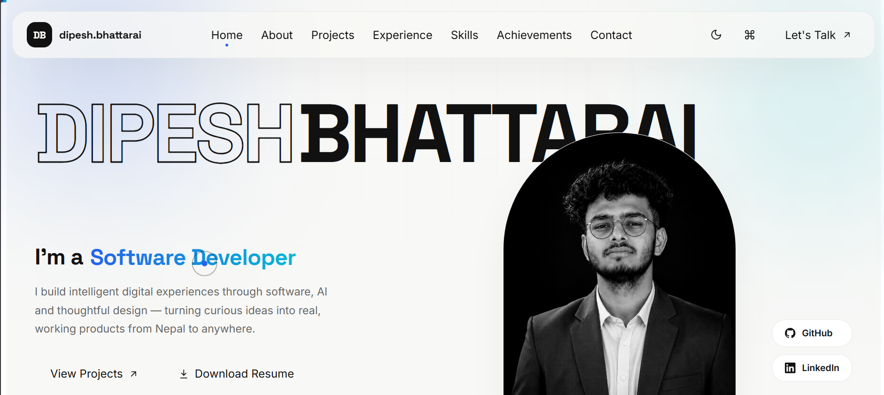
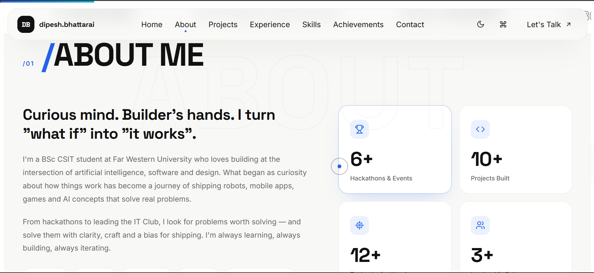
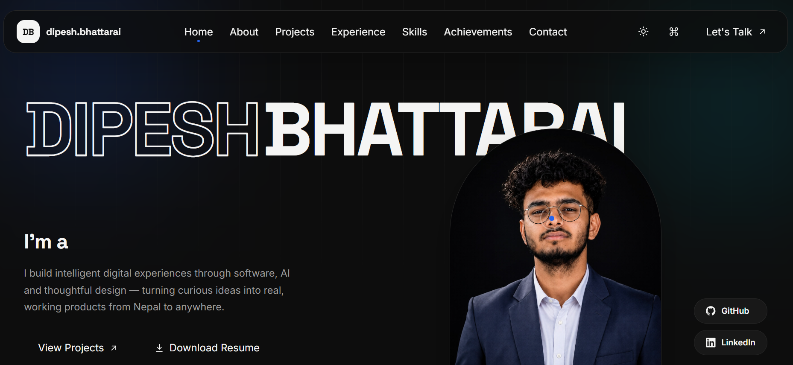

# Dipesh Bhattarai — Portfolio

[](https://react.dev/)
[](https://vitejs.dev/)
[](https://www.framer.com/motion/)
[](./LICENSE)

Personal portfolio website for Dipesh Bhattarai, a BSc CSIT student at Far Western University, Nepal.

This is a single-page React app with [Framer Motion](https://www.framer.com/motion/) for animation: a scroll-aware nav, command palette (⌘K), light/dark mode, filterable project grid, and animated stat counters.

Available screenshots in the repo:

- `./gitss/homepage.png`
- `./gitss/aboutmepage.png`
- `./gitss/nightversionmode.png`

## Overview



I wanted the site to feel clean and personal while still showing the work clearly. It includes a hero section, animated role text, project highlights, experience, and a contact section.

## Sections

- **Hero** — animated name reveal and rotating role titles
- **About** — bio + animated stat counters
- **Projects** — filterable grid (Human Following Cart, WorkDipZ, Najik Ko Sathi, Charo Game)
- **Experience** — IT Club, KYC 2025, Thrive 2025
- **Skills** — programming languages, tools
- **Achievements** — hackathons, exhibitions, leadership, certificates
- **Contact** — email, LinkedIn, GitHub

## Projects



The project section is meant to feel simple and easy to scan. I kept each card focused on what the project was and what I built, with filtering so the portfolio stays readable as the list grows.

## Theme and Layout



The site supports a light and dark mode, and the theme is handled with CSS custom properties rather than a heavy UI framework.

## Tech Stack

- [React 18](https://react.dev/)
- [Framer Motion](https://www.framer.com/motion/)
- [Vite](https://vitejs.dev/)
- Plain CSS (CSS custom properties for theming, no framework)

## Getting Started

```bash
# install dependencies
npm install

# start the dev server
npm run dev

# build for production
npm run build

# preview the production build
npm run preview
```

The dev server runs at `http://localhost:5173` by default.

## Deploying

The build output in `dist/` is fully static and can be deployed to any static host:

- **Vercel** — import the repo, framework preset "Vite", no config needed
- **Netlify** — build command `npm run build`, publish directory `dist`
- **GitHub Pages** — build locally and push `dist/` to a `gh-pages` branch, or use an action like `peaceiris/actions-gh-pages`

## Project Structure

```text
├── index.html              # HTML entry point
├── public/                 # Static assets
├── gitss/                  # Screenshots used in the README
│   ├── homepage.png
│   ├── aboutmepage.png
│   └── nightversionmode.png
├── src/
│   ├── main.jsx            # React root
│   ├── App.jsx             # Main sections and logic
│   └── components/         # Reusable UI pieces and effects
├── package.json
├── vite.config.js
├── LICENSE
├── README.md
└── .gitignore
```

## Contact

- Email: dipeshbh121@gmail.com
- LinkedIn: [dipesh-bhattarai](https://www.linkedin.com/in/dipesh-bhattarai-2b286736a)
- GitHub: [@dipeshbh7](https://github.com/dipeshbh7)

## License

MIT — see [LICENSE](./LICENSE).
